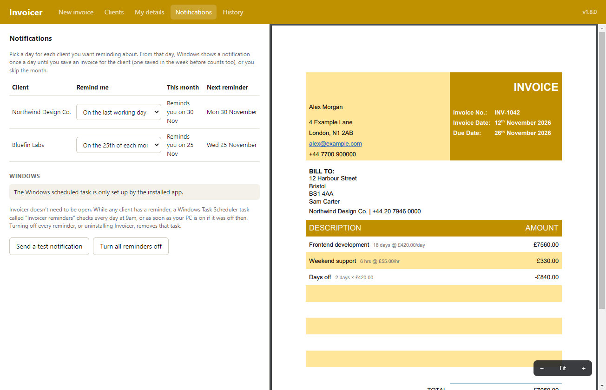

# Invoicer

A small, no-fuss Windows app for freelancers who invoice the same clients every month. Pick a client, fill in your days or hours, and save a clean PDF invoice. Invoicer remembers the rest.

## Install

**[⬇ Download the latest version](https://github.com/BryceH1996/invoicer/releases/latest)**

1. Download `Invoicer-Setup-<version>.exe` from the [latest release](https://github.com/BryceH1996/invoicer/releases/latest).
2. Run it. Invoicer isn't code-signed yet, so your browser may say the file "isn't commonly downloaded" (choose **Keep**), and Windows may show "Windows protected your PC" (click **More info → Run anyway**). See [Is it safe?](#is-it-safe)
3. Fill in **My details**, add a client under **Clients**, and make your first invoice.

Invoicer keeps itself up to date after that. To remove it, go to **Settings → Apps → Installed apps → Invoicer → Uninstall**. Your invoices and data are kept.


## What it does

- **Clients:** each client keeps its address, payment terms, currency (GBP, USD, EUR or ZAR), hourly rate, daily rate and day-off reduction.
- **Pricing:** add lines as days, hours, days off or fixed amounts, and the total is worked out from the client's rates.
- **Your look:** choose from three templates (Classic, Wave and Minimal) in any colour, and add your company logo.
- **Business details:** your company name, VAT, tax and registration numbers, plus each client's VAT number. Set a tax rate for a client to add a VAT line to their invoices.
- **Live preview:** the PDF updates as you type. Zoom with − / +, or Ctrl + / Ctrl − / Ctrl 0.
- **A folder per client:** **Save invoice** puts the PDF straight into that client's folder, e.g. `Documents\Invoicer\Northwind Design Co\Northwind Design Co. Invoice - November 2026 - Alex Morgan.pdf`.
- **Numbering:** invoice numbers carry on from the last one you saved.
- **History:** every saved invoice, ready to open, save again, or copy into a new one.
- **Reminders:** pick a day each month for each client on the **Notifications** tab. Windows then reminds you once a day until you've invoiced them, even when Invoicer is closed.
- **Backups:** if you use Google Drive for desktop, every saved invoice is also copied to your Google Drive.



## Is it safe?

Each [release](https://github.com/BryceH1996/invoicer/releases) lists the installer's **SHA-256 checksum**. To check that your download is exactly the published file, run this in PowerShell in the folder you saved it to, and compare the result:

```powershell
Get-FileHash .\Invoicer-Setup-<version>.exe
```

Releases also link a **VirusTotal** scan of the installer, and all of the source code is in this repository.

**What Invoicer does on your PC:**
- **Your data:** it saves your data as plain files on your PC (see [Your data](#your-data)). There are no accounts, tracking or analytics, and Invoicer never uploads anything itself.
- **Reminders:** while at least one client has a reminder, it adds a scheduled task called "Invoicer reminders" that runs once a day at 9am. Turning off your last reminder, or uninstalling, removes it.
- **Updates:** it checks this repository's releases when it starts and every 30 minutes. It only downloads and installs an update when you click **Restart & update**.
- **Backups:** if Google Drive for desktop is installed, it copies saved invoices into your `My Drive` folder, and Google Drive uploads them as usual. Invoicer never signs in to Google itself.

## Your data

Everything is in `Documents\Invoicer` (**My details → Data** shows the exact folder, and lets you move it):

| File | What's in it |
| --- | --- |
| `clients.json` | Your clients and their rates |
| `settings.json` | Your details and invoice settings |
| `invoices.json` | The history of saved invoices |
| `logo.png` (or `.jpg`, …) | Your logo, if you've added one |
| `<Client>\*.pdf` | Your invoices, one folder per client |

Invoicer's app folder, `%APPDATA%\Invoicer`, also remembers which data folder you use and when each reminder last showed. To back everything up, or to use the same data on another PC, move the data folder into OneDrive or similar.

---

## For developers

Built with [Electron](https://www.electronjs.org/) and [jsPDF](https://github.com/parallax/jsPDF).

```bash
npm install
npm start          # run it
npm run dist       # build dist/Invoicer Setup <version>.exe
```

To release, bump `version` in `package.json`, then run `npm run release -- "What changed"`. The script:
1. builds the installer
2. copies it into `<data folder>/updates`
3. commits, tags `v<version>`, and pushes to the `origin` and `public` remotes
4. creates the GitHub Release on the public repo (`updateRepo` in `package.json`) with the installer attached
5. adds the SHA-256, and the VirusTotal result if `VIRUSTOTAL_API_KEY` is set, to the release notes

It refuses to reuse a version number. Use `--no-build` to reuse the installer in `dist/`, or `--github-only` to redo just the GitHub Release.

| Path | What it is |
| --- | --- |
| `main.js` | Main process: window, storage, saving, backups, reminders, updates |
| `preload.js` | Bridge between the UI and the main process |
| `app/` | UI (`index.html`, `renderer.js`, `style.css`) and the PDF layout (`pdf.js`) |
| `scripts/release.js` | The release script |
| `build/` | App icon; `installer.nsh` removes the reminder task on uninstall |
| `docs/` | README screenshots (invented sample data) |
| `prototype/invoicer.html` | The original single-file browser version |

© All rights reserved. The code is public so you can see what the app does. It isn't licensed for reuse.
