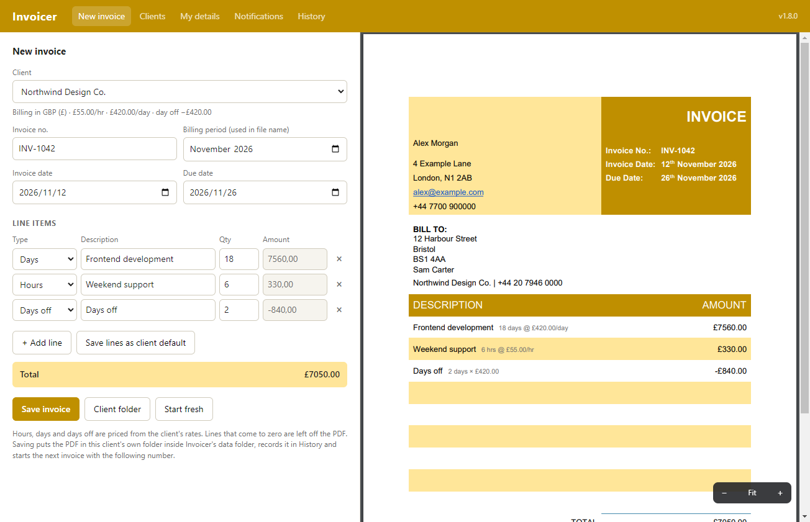

<p align="center"></p>

<h1 align="center">Invaro</h1>

<p align="center"><strong>Simple invoices for the clients you bill every month.</strong></p>

<p align="center">
  <a href="https://github.com/BryceH1996/Invaro/releases/latest"><strong>⬇ Download for Windows or Mac</strong></a> ·
  <a href="https://bryceh1996.github.io/Invaro/">Website</a> ·
  <a href="https://bryceh1996.github.io/Invaro/privacy.html">Privacy</a>
</p>

Invaro is a small, free app for Windows and Mac. Pick a client, fill in your days or hours, and save a clean PDF invoice. Invaro remembers the rest. Use it on your own, or share the work with your partner or team. There are no ads, no tracking and no analytics.

Invaro was called **Invoicer** up to version 1.14. If you used it then, it carries on with your existing folders (the ones still named `Invoicer`), so nothing moves.

## Install

**Windows**
1. Download `Invaro-Setup-<version>.exe` from the [latest release](https://github.com/BryceH1996/Invaro/releases/latest).
2. Run it. Invaro isn't code-signed yet, so your browser may say the file "isn't commonly downloaded" (choose **Keep**), and Windows may show "Windows protected your PC" (click **More info → Run anyway**). See [Is it safe?](#is-it-safe)

To remove it, go to **Settings → Apps → Installed apps → Invaro → Uninstall**.

**Mac** (Apple silicon and Intel, macOS 12 Monterey or later)
1. Download `Invaro-<version>-mac.dmg` from the [latest release](https://github.com/BryceH1996/Invaro/releases/latest), open it, and drag **Invaro** into **Applications**.
2. Open Invaro from Applications. Because it isn't signed by Apple, macOS first says it can't check the app for malware. Click **Done**, then open **System Settings → Privacy & Security**, scroll down to "Invaro was blocked…", click **Open Anyway**, and confirm. You only need to do this once.

To remove it, turn off any reminders on the **Notifications** tab first, then drag Invaro from Applications to the Bin.

**Then**, fill in **My details**, add a client under **Clients**, and make your first invoice. Invaro keeps itself up to date after that. Removing the app keeps your invoices and data.



## What it does

### Invoicing
- **Saved clients:** each client keeps its address, payment terms, currency (GBP, USD, EUR or ZAR), hourly rate, daily rate and day-off reduction.
- **Priced for you:** add lines as days, hours, days off, items (a quantity at a price each) or fixed amounts, and the total is worked out from the client's rates. Set a tax rate for a client to add a VAT line.
- **As many lines as you need:** long descriptions wrap, and a long invoice carries on over more pages with the table header repeated and "Page 1 of 3" at the bottom. When every line is hours, the Qty column says Hours.
- **Show or hide rates:** untick **Show rates on the PDF** to leave your hourly, daily and unit rates off an invoice or quote, showing just the quantities and amounts. New ones start the way you last chose.
- **Discounts:** click **%** beside any line to take a percentage or a whole amount off it. The saving shows as its own line under it, and comes off before the total and VAT.
- **Discount on the whole invoice:** tick **Discount on the whole invoice**, then type a percentage and a reason (e.g. "Loyal customer"). It shows as the last line, with the amount it was taken from, before VAT.
- **Live preview:** the PDF updates as you type. Zoom with − / +, or Ctrl (⌘ on a Mac) with + / − / 0. On **Clients**, the preview shows how the selected client appears on an invoice; on **My details**, an example invoice with your details, design and banking.
- **A folder per client:** **Save invoice** puts the PDF straight into that client's folder, e.g. `Documents/Invaro/Northwind Design Co/Northwind Design Co. Invoice - November 2026 - Alex Morgan.pdf`.
- **Numbering:** invoice numbers carry on from the last one you saved, and never clash in a team.
- **Quotes:** switch **New invoice** to **Quote** for a quote with its own numbering and a "valid until" date, then turn it into an invoice with one click. Itemise it with **Item** lines (a quantity at a price each).
- **Quotes paid in steps:** in **History**, click **Payments** on a quote and tick off each line as the client pays for it. Invaro shows what's been paid and what's still outstanding.
- **History:** every saved invoice. Click one to see it on the right, then open it, **Show in folder**, save it again, edit it or copy it into a new one.
- **Edit before you send:** click **Edit** on any saved invoice or quote to change values or add lines, then **Save changes**. It keeps its number, file and paid status, and whatever you were drafting comes back afterwards.

### Stock
- **Your stock list:** on the **Stock** tab, add the items you sell with a code, unit (each, m, kg, box…), category, supplier, cost price and a selling price in each currency you bill in. Search and filter by category, and see the value of what's on hand at cost.
- **On quotes and invoices:** click **+ Add from stock** to add an item at its price in the client's currency. You can still change the description, quantity and price on the line. Tick **Show item codes on invoices and quotes** to print the code with each line.
- **Counts that keep themselves:** saving an invoice takes its items off what's on hand. Editing it later changes only the difference, and removing it from History puts the items back. Quotes don't take stock until they're made into an invoice. Invaro warns you before an invoice takes more than you have.
- **Receive and count:** record stock received, taken out or counted, with a note. Each item keeps its own history, and you can set a level for a low-stock warning.
- **Import from a spreadsheet:** click **Import CSV…** to add new items and update existing ones from a CSV file (Excel: File → Save As → CSV). Rows match your items by code, or by name when there's no code, and empty cells leave things as they are. You see every change, and every stock count that would change, before anything is saved. **Download a template** shows the columns, and **Export stock list** gives a file you can edit and import again.
- **Pictures:** add a picture to any item (it's kept small, so it syncs with the item). Pictures show in the stock list and when you add stock to an invoice, and items from your WooCommerce shop bring their shop picture.
- **Import from your WooCommerce shop:** connect your WordPress shop with a read-only REST API key (WooCommerce → Settings → Advanced → REST API) and click **Import from WooCommerce** to bring in your products, with each variation as an item of its own: names, codes, categories, prices in your shop's currency and stock levels. Run it again whenever your shop changes. Invaro only reads from your shop, and the key stays on your computer.
- **In a team:** everyone sees the stock and can add it to invoices and quotes; only admins add items, change prices or update counts.

### Moving from another app
- **QuickBooks, Xero, Sage, Wave, Zoho, FreshBooks or a spreadsheet:** export your customers, products and services, and invoices as CSV or Excel (.xlsx), then choose the file with **Import…** on Clients, **Import invoices…** on History, **Import CSV…** on Stock, or **My details → Moving from another app**. Invaro recognises each app's column names, skips report headings and total rows, and shows exactly what will be added or filled in before anything changes. Clients you already have only get the details they're missing.
- **Imported invoices** come into History with their paid or unpaid status and count in Reports and the Dashboard. They don't take stock off (that happened in the old app), and your invoice numbering carries on after the highest number.
- **Old PDF invoices:** on History, click **Add old PDFs…** and choose the files. Invaro reads each PDF on your computer and suggests its client, number, dates, total and VAT; you check them in a table, and each PDF is copied into its client's folder and shown in History as it is.

### How it's going
- **Your currency:** set it in **My details**. Amounts owed to you in other currencies then show what they're worth in yours today, in brackets, e.g. £1786.00 (R39912), in History, the overdue bars, Reports, the Dashboard and Ask Invaro, at Standard Bank's, Absa's or Nedbank's buying rate.
- **Dashboard:** with your currency set, it adds everything up in it (each payment at the rate on the day it was made where Invaro has one, the rest at today's rate), shows what you've earned this year, and splits the year by currency; pick a single currency to see it on its own. It also shows this month against last month and the same month last year, what's been paid, what you're owed and what's overdue, open quotes, a chart of the last 12 months (invoiced and paid), your top clients and best-selling stock, and a short list of things worth knowing, each with a button to act on it.
- **Ask Invaro:** click **💬 Ask** (or press Ctrl+K) and ask in your own words: "who owes me money?", "how much did I invoice in October?", "what's low on stock?", "how do I make a quote?". It answers from your own data and Invaro's help, with buttons that take you to the right place. It's built into Invaro and runs on your computer: nothing you type is sent anywhere. Optionally, add your own (free) Gemini API key in **My details → Ask Invaro with Gemini**, and questions it can't answer itself go to Google's Gemini with a summary of your figures. On Google's free tier, Google may use what's sent to improve its products.

### Your look
- **Nine designs:** Classic, Wave, Minimal, Bold, Elegant, Sidebar, Corporate, Mono and Geometric, in any colour, with a second colour on two-tone designs to match your branding, plus your company logo.
- **Business details:** your company name, VAT, tax and registration numbers, plus each client's VAT number.
- **EFT details:** print your bank, account holder, account number, account type, branch code, SWIFT code and payment reference at the bottom of every invoice, with your bank's logo. Pick a South African bank to fill in its branch and SWIFT codes.

### Staying on top
- **Reminders:** pick a day each month for each client on the **Notifications** tab. Your computer then reminds you once a day until you've invoiced them, even when Invaro is closed.
- **Paid or not:** mark invoices paid in **History**. Unpaid invoices past their due date show as overdue, and you're reminded the day after, then weekly.
- **Part payments:** click **Payments** next to an invoice in **History** to record each amount as it comes in, with its date and a note. The invoice shows what's still owed ("£635.00 left"), counts only that as owed everywhere, and is marked paid once the payments cover it.
- **Credit notes:** to cancel an invoice or take part of it off, click it in **History** and choose **Credit note**. It starts as the whole invoice at the prices and VAT it was billed at; change or remove lines to credit only part, give a reason, and save. It has its own numbering (CN-1, CN-2…), prints in your design without banking details, comes off what the client owes, and counts as a negative amount (VAT included) in Reports. In a team, only admins make credit notes.
- **Client statements:** on **Clients**, the **Statement** box shows what a client owes and saves a statement PDF: their invoices, credit notes and payments with a running balance, the balance brought forward, how overdue it is (1–30, 31–60, 61–90 and over 90 days) and your banking details. The overdue bars, invoice reminders and Ask Invaro offer one when a client owes you.
- **Reports:** see what you've invoiced, been paid, are owed and charged in VAT for a tax year or calendar year, by client and by month, and export it to a spreadsheet. Choose when your tax year starts: 1 March (South Africa), 6 April (UK personal tax), 1 July (Australia) or the 1st of any month for a company year end.
- **In rand:** tick **Also show what's been paid in rand** in Reports and choose a bank (Standard Bank, Absa or Nedbank). What's been paid on invoices in pounds, dollars or euros then shows its rand value, at that bank's buying rate (what the bank pays for the foreign currency) on the day each payment was made. Part payments each get the rate of their own day, as the rand moves between them. Every bank's rate is kept with the invoice when you mark it paid, and you can type in your own, such as the rate you actually got.

### Working together
- **Teams:** create a team and invite your partner or colleagues by email. Everyone works on the same clients, invoices and business details, kept in sync within seconds. Whoever creates the team is its admin and gives everyone a role:
  - **Admin:** everything, including who's in the team.
  - **Accountant:** sees all clients, invoices and reports, and marks invoices paid.
  - **Team member:** makes invoices and quotes and sees only their own, without changing rates, paid status or the business details.

  The database enforces the roles, not just the app. If two people change the same thing, the later change wins and the other version is kept in a `conflicts` folder.
- **Personal items:** tick **Personal** on a client or an invoice, before or after you share, to keep it out of the team.
- **Share your invoices:** with Google Drive connected, type your partner's or company's email to give them view or edit access to your backup folder. They see each invoice as soon as it's saved.

### Backups and sync
- **Backups:** every saved invoice is also copied to Google Drive (My Drive or a shared drive), OneDrive, or any other folder you choose, into a folder of your choice with a folder per client (**My details → Invoice backup**). **Connect Google Drive** to back up without Google Drive for desktop.
- **Sign in with Google (optional):** back up your clients, settings, logos and invoice history to your own private account, and use them on your other computers. Accounts are invite-only for now. If you're not approved yet, Invaro tells you how to ask for access when you sign in.


## Is it safe?

Each [release](https://github.com/BryceH1996/Invaro/releases) lists a **SHA-256 checksum** for every download. To check that your download is exactly the published file, run one of these in the folder you saved it to, and compare the result:

```powershell
Get-FileHash .\Invaro-Setup-<version>.exe     # Windows, in PowerShell
```
```bash
shasum -a 256 Invaro-<version>-mac.dmg       # Mac, in Terminal
```

Releases also link a **VirusTotal** scan of the Windows installer and the Mac disk image, and all of the source code is in this repository.

**What Invaro does on your computer:**
- **Your data:** it saves your data as plain files on your computer (see [Your data](#your-data)). There's no tracking or analytics, and nothing leaves your computer unless you sign in, join a team or set up a backup.
- **Your account (only if you sign in):** your clients, settings, logos and invoice history are synced to your own account, which only you can read. Your PDFs aren't uploaded. **My details → Account & sync → Delete my cloud data** removes it. See the [privacy policy](https://bryceh1996.github.io/Invaro/privacy.html).
- **Your team (only if you join one):** the team's clients, invoices and business details are shared with its members, and each person sees only what their role allows. Personal clients and invoices stay on your computer.
- **Reminders:** while at least one client has a reminder or an invoice is unpaid, it schedules a quick check once a day at 9am. On Windows that's a Task Scheduler task called "Invaro reminders"; on a Mac it's a launch agent called `local.invoicer.reminders`, which also checks when you log in. Turning off your last reminder removes it, and on Windows so does uninstalling.
- **Exchange rates (only with rand reports on):** it reads the public exchange-rate pages of Standard Bank, Absa and Nedbank for the days your invoices in other currencies were paid. Only a date is sent, and each day's rates are remembered on your computer.
- **Updates:** it checks this repository's releases when it starts and every 30 minutes. It only downloads and installs an update when you click **Restart & update**.
- **Backups:** saved invoices are copied into `Invaro Backups` (or a folder you pick) inside your `My Drive` folder (Google Drive for desktop) or your `OneDrive` folder, or into any folder you pick, and the sync app uploads them as usual. Without Google Drive for desktop you can instead **Connect Google Drive**: Invaro then uploads each saved PDF to that folder in My Drive or a shared drive you pick, and nothing else. **Disconnect Google Drive** removes its access.

## Your data

Everything is in the `Invaro` folder in your Documents (or `Invoicer`, if you've used it since before the rename). **My details → Data** shows the exact folder, and lets you move it:

| File | What's in it |
| --- | --- |
| `clients.json` | Your clients and their rates |
| `settings.json` | Your details and invoice settings |
| `invoices.json` | The history of saved invoices |
| `logo.png` (or `.jpg`, …) | Your logo, if you've added one |
| `bank-logo.png` (or `.jpg`, …) | Your bank's logo, if you've added one |
| `<Client>/*.pdf` | Your invoices, one folder per client |

Invaro's app folder also remembers which data folder you use, when each reminder last showed, and (if you sign in) your sign-in, encrypted by the operating system. It's `%APPDATA%\Invaro` on Windows and `~/Library/Application Support/Invaro` on a Mac (or `Invoicer` in place of `Invaro`, for installs from before the rename). To back everything up, or to use the same data on another computer, move the data folder into OneDrive, iCloud Drive or similar.

---

## For developers

Built with [Electron](https://www.electronjs.org/) and [jsPDF](https://github.com/parallax/jsPDF).

```bash
npm install
npm start          # run it
npm run dist       # build dist/Invaro Setup <version>.exe (on Windows)
npm run dist:mac   # build the Mac .dmg and .zip (on a Mac)
```

To release, bump `version` in `package.json`, then run `npm run release -- "What changed"` on Windows. The script:
1. builds the Windows installer
2. copies it into `<data folder>/updates`
3. commits, tags `v<version>`, and pushes to the `origin` and `public` remotes
4. creates the GitHub Release on the public repo (`updateRepo` in `package.json`) with the installer attached. That starts `.github/workflows/mac.yml`, which builds the Mac version on a GitHub Mac, smoke-tests it (`scripts/mac-smoke-test.js`) and attaches the `.dmg` and `.zip`
5. waits for the Mac files, then adds every file's SHA-256 to the release notes, plus VirusTotal results if `VIRUSTOTAL_API_KEY` is set

It refuses to reuse a version number. Use `--no-build` to reuse the installer in `dist/`, or `--github-only` to redo just the GitHub Release.

| Path | What it is |
| --- | --- |
| `main.js` | Main process: window, storage, saving, backups, reminders, updates |
| `preload.js` | Bridge between the UI and the main process |
| `app/` | UI (`index.html`, `style.css`) and the PDF layout (`pdf.js`). `renderer.js` holds the shared pieces (saving, numbering, preview, backups, My details, reminders, updates, start-up); each tab has its own file: `editor.js` (New invoice), `clients.js`, `history.js`, `reports.js` (with the exchange rates), `stock.js`, `dashboard.js`, `assistant.js` (Ask Invaro), `importer.js`, and `account.js` (Account & sync, teams and roles) |
| `test/` | Unit tests (`npm test`): `harness.js` loads the `app/` scripts into Node so the tests run the real code |
| `cloud.js` | Sign-in with Google (via Supabase) and cloud sync |
| `team.js`, `supabase/teams.sql` | Teams: shared data synced record by record, and its database |
| `supabase/signup-allowlist.sql` | Invite-only sign-up: the approved list and its auth hook |
| `gdrive.js` | Connect Google Drive: uploads backups and shares the backup folder |
| `docs/` | The website (GitHub Pages): homepage and privacy policy, plus README screenshots (invented sample data) |
| `scripts/release.js` | The release script |
| `.github/workflows/mac.yml`, `scripts/mac-smoke-test.js` | The Mac build and its smoke test |
| `.github/workflows/supabase-keepalive.yml` | Keeps the Supabase project awake with a read every 3 days |
| `build/` | App icon; `installer.nsh` removes the reminder task on uninstall |
| `prototype/invoicer.html` | The original single-file browser version |

### Cloud sync (Supabase)

`package.json` → `cloud` holds the Supabase project URL and its **publishable** key. That key is meant to be public; row level security keeps each user's data private. The database needs:

```sql
create table public.documents (
  user_id    uuid not null default auth.uid() references auth.users on delete cascade,
  name       text not null check (name in ('clients', 'settings', 'invoices')),
  data       jsonb not null,
  updated_at timestamptz not null default now(),
  primary key (user_id, name)
);
alter table public.documents enable row level security;
create policy "Users manage their own documents" on public.documents
  for all using (auth.uid() = user_id) with check (auth.uid() = user_id);

-- Lets "Delete my cloud data" remove the whole account, not just its rows.
create or replace function public.delete_own_account() returns void
  language sql security definer set search_path = '' as $$ delete from auth.users where id = auth.uid(); $$;
revoke all on function public.delete_own_account() from public, anon;
grant execute on function public.delete_own_account() to authenticated;
```

Google is the sign-in provider, and `http://127.0.0.1:47823/auth/callback` must be in **Authentication → URL Configuration → Redirect URLs**.

Sign-up is invite-only: [`supabase/signup-allowlist.sql`](supabase/signup-allowlist.sql) adds an approved-emails list and a **Before User Created** auth hook (Authentication → Auth Hooks → `public.hook_before_user_created`) that turns everyone else away.

Teams also need the tables, row level security and functions in [`supabase/teams.sql`](supabase/teams.sql). Run that file once in the SQL editor; it replaces `delete_own_account` above with a version that knows about teams.

© All rights reserved. The code is public so you can see what the app does. It isn't licensed for reuse.
